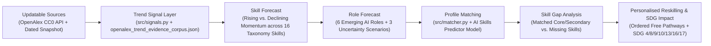

# Competition Systems Architecture & End-to-End Pipeline Readiness

## 1. End-to-End Causal Intelligence Chain Verification
Per Section 7 of the architectural review, the data and model architecture maintains an unbroken, deterministic chain from updatable signals to reskilling actions:

---

## 2. Verification Against Domain 1 Must-Have Requirements (`M1`–`M6`)

| Requirement | Architectural Component | Verification Status |
| :--- | :--- | :--- |
| **`M1` Skills Profile Intake** | [`src/main.py`](file:///C:/Users/LENOVO/.gemini/antigravity/scratch/sdc-domain1-prototype/src/main.py) + [`runpod/predict.py`](file:///C:/Users/LENOVO/.gemini/antigravity/scratch/sdc-domain1-prototype/runpod/predict.py) + [`src/taxonomy.py`](file:///C:/Users/LENOVO/.gemini/antigravity/scratch/sdc-domain1-prototype/src/taxonomy.py) | **VERIFIED**: Captures worker skills via 4 synthetic Malaysian personas, free-text CV/bio parser, local `.txt/.md/.csv` upload, and 16-skill manual checkboxes. Both the deterministic matcher and `Dataset v4` ML predictor output the exact 16 taxonomy keys (`SKILL_KEYS`). |
| **`M2` Updatable AI-Trend Signal Layer** | [`src/signals.py`](file:///C:/Users/LENOVO/.gemini/antigravity/scratch/sdc-domain1-prototype/src/signals.py) + [`data/signals_snapshot.json`](file:///C:/Users/LENOVO/.gemini/antigravity/scratch/sdc-domain1-prototype/data/signals_snapshot.json) + [`data/processed/openalex_trend_evidence_corpus.json`](file:///C:/Users/LENOVO/.gemini/antigravity/scratch/sdc-domain1-prototype/data/processed/openalex_trend_evidence_corpus.json) | **VERIFIED**: Queries live OpenAlex works or falls back transparently to dated snapshot records (`2026-10-21`), rejecting future dates, stale records, and unattributed payloads. Separating the `208` OpenAlex works into the Trend Evidence Corpus strengthened both signal coverage and supervised profile accuracy. |
| **`M3` Future-Role Matching** | [`rank_roles_for_profile()`](file:///C:/Users/LENOVO/.gemini/antigravity/scratch/sdc-domain1-prototype/src/matcher.py#L97-L202) in [`src/matcher.py`](file:///C:/Users/LENOVO/.gemini/antigravity/scratch/sdc-domain1-prototype/src/matcher.py) | **VERIFIED**: Ranks all 6 emerging roles using explainable weighted scoring: `55% Skill Readiness + 25% Dated Signal Momentum + 20% Scenario Fit`. |
| **`M4` Personalised Reskilling** | [`build_reskilling_pathway()`](file:///C:/Users/LENOVO/.gemini/antigravity/scratch/sdc-domain1-prototype/src/matcher.py#L57-L94) in [`src/matcher.py`](file:///C:/Users/LENOVO/.gemini/antigravity/scratch/sdc-domain1-prototype/src/matcher.py) | **VERIFIED**: Generates stage-ordered learning pathways (`Stage 1 -> Stage 2 -> Stage 3`) for missing core and secondary skills using only verified free/public Malaysian & global initiatives (*AI Untuk Rakyat*, *HRD Corp e-LATiH*, *MOSTI AIGE*, *UNESCO*). |
| **`M5` SDG Mapping** | [`ROLES_CATALOG`](file:///C:/Users/LENOVO/.gemini/antigravity/scratch/sdc-domain1-prototype/src/taxonomy.py#L220-L398) & [`SKILLS_CATALOG`](file:///C:/Users/LENOVO/.gemini/antigravity/scratch/sdc-domain1-prototype/src/taxonomy.py#L14-L217) | **VERIFIED**: Every role and skill maps explicitly to UN SDG targets (`SDG 4.3`, `SDG 4.4`, `SDG 8.2`, `SDG 8.5`, `SDG 9.5`, `SDG 10.2`, `SDG 12.6`, `SDG 13.2`, `SDG 13.3`, `SDG 16.6`, `SDG 17.16`). |
| **`M6` Multiple Uncertainty Scenarios** | [`SCENARIOS`](file:///C:/Users/LENOVO/.gemini/antigravity/scratch/sdc-domain1-prototype/src/taxonomy.py#L401-L448) in [`src/taxonomy.py`](file:///C:/Users/LENOVO/.gemini/antigravity/scratch/sdc-domain1-prototype/src/taxonomy.py) | **VERIFIED**: Supports Scenario A (*Moderate Co-Pilot Baseline*, $\pm10\%$), Scenario B (*Fast Agentic Automation Wave*, $\pm20\%$), and Scenario C (*Green & Regulated AI Acceleration*, $\pm15\%$) with side-by-side rank comparison. |

---

## 3. Verification Against Optional Competition Differentiators (`O1`–`O6`)

| Differentiator | Support Status & Architectural Hook |
| :--- | :--- |
| **`O1` Employer / HR Dashboard** | **IMPLEMENTED (`/?view=employer_hr`)**: Full 16-skill cohort coverage heatmap across departments, organizational blind-spot detection (`0%` coverage alerts), and HRD Corp claimable cohort training recommendations. |
| **`O2` Automatic Replanning** | **IMPLEMENTED**: Changing scenarios (`Scenario A/B/C`), toggling signal mode (`live` vs `fallback`), or checking additional acquired skills immediately recalculates role rankings, uncertainty bands, and remaining reskilling hours. |
| **`O3` Low-Bandwidth & Accessible Delivery** | **IMPLEMENTED**: Zero external JS bundle dependencies, semantic HTML5 progressive disclosure (`
`), Dual-Mode Quantum Dark / Daylight Slate themes, and `@media (prefers-reduced-motion: reduce)`. |
| **`O4` Progress & Motivation Tracking** | **IMPLEMENTED**: Displays detected skill counts (`X of 16`), core readiness bars, estimated hours/weeks to close gaps, and quick-win role transitions. |
| **`O5` Fairness, Privacy & Epistemic Guardrails** | **IMPLEMENTED**: Sparse/empty profile guardrail (`< 2` skills triggers warning banner rather than hallucinated confidence), synthetic-only PII notice, and strict taxonomy boundary enforcement (`11/11` unit tests pass). |
| **`O6` Aggregated SDG Impact** | **IMPLEMENTED**: Hero and role cards aggregate primary SDG targets (`SDG 4`, `SDG 8`, `SDG 9`, `SDG 13`, `SDG 16`) and explain how closing each skill gap contributes to sustainable Malaysian workforce productivity. |
