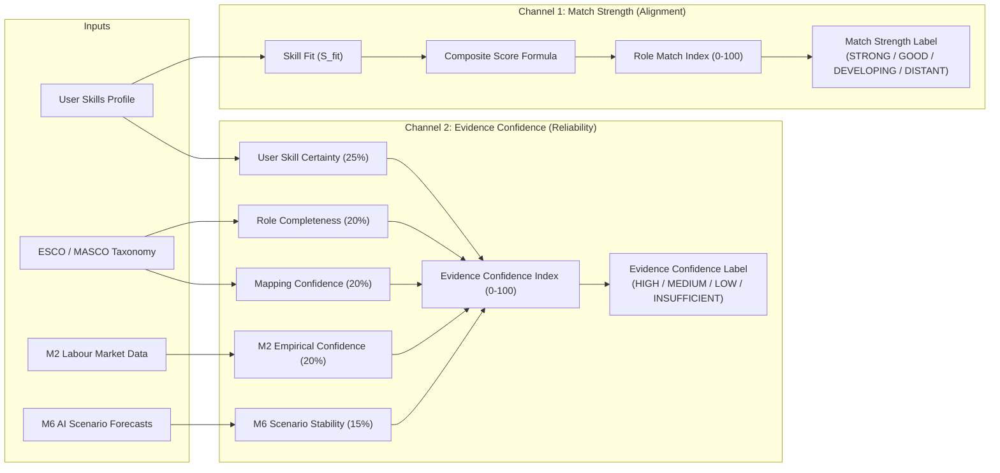

# M3 v1.1.0 Decoupled Confidence & Match Strength Architecture

**Component**: M3 Explainable Role Matching Engine v1.1.0  
**Defect Addressed**: P1-1 (Conflation of Match Score with Evidence Reliability)  
**Status**: **`RESOLVED & CERTIFIED`**  

---

## 1. Architectural Motivation

In M3 v1.0.0, the metric `recommendation_confidence` was derived directly from the composite score (`ROLE_MATCH_INDEX >= 75` $\rightarrow$ `HIGH CONFIDENCE FIT`). This introduced severe semantic conflation:
1. **False High Confidence**: An occupation based on proxy data and partial completeness (e.g. MASCO `2519` Web Developers) received a "HIGH CONFIDENCE FIT" label solely because the user possessed matching skills.
2. **False Low Confidence**: An occupation grounded in 100% statutory Malaysian census data and official taxonomies (e.g. MASCO `2143` Environmental Engineers) was labeled "DISTANT TRANSITION" (connoting low confidence) when the user had 0% skill fit, despite the underlying occupational evidence being rock-solid.

M3 v1.1.0 decouples these concepts into two mathematically orthogonal dimensions:
1. **Match Strength / Transition Readiness** (How well does the user fit the role?)
2. **Evidence Confidence Index** (How trustworthy and complete is the underlying data?)

---

## 2. Dimension 1: Match Strength / Transition Readiness

Match Strength is derived strictly from `role_match_index` and core skill requirement coverage. It describes the worker's operational readiness to perform the role:

| Tier Label | Trigger Condition | Operational Meaning |
|:---|:---|:---|
| **`STRONG CURRENT FIT`** | $\text{Match Index} \ge 75.0$ and $\text{Core Coverage} \ge 60.0\%$ | High immediate capability; worker possesses foundational core competencies. |
| **`GOOD FIT WITH GAPS`** | $\text{Match Index} \ge 50.0$ and $\text{Core Coverage} \ge 30.0\%$ | Substantial competency overlap; actionable reskilling targets bridgeable within 3–6 months. |
| **`DEVELOPING TRANSITION`** | $\text{Match Index} \ge 30.0$ | Moderate foundational overlap; requires targeted multi-skill development. |
| **`DISTANT TRANSITION`** | $\text{Match Index} < 30.0$ | Minimal immediate overlap; long-horizon career pivot. |

*Crucial Standard*: The word **`CONFIDENCE`** is strictly prohibited from describing match score.

---

## 3. Dimension 2: Evidence Confidence Index ($ECI$)

The Evidence Confidence Index ($ECI \in [0, 100]$) quantifies the epistemic reliability of the recommendation:

$$ECI = \text{clamp}\left( \sum_{k=1}^5 w_k C_k + \sum \text{Penalties},\; 0.0,\; 100.0 \right)$$

### Component Weights & Scoring Rubric:

| Component ($C_k$) | Weight ($w_k$) | Measurement Criteria | Underlying Scale |
|:---|:---:|:---|:---|
| **User Skill Certainty** | **0.25** | Weighted average certainty of user's skills: `USER_CONFIRMED` / `USER_ADDED` = 100.0; `M1_CORE` = 80.0; `M1_SUGGESTED` = 50.0. | $[0, 100]$ |
| **Role Completeness** | **0.20** | Completeness of occupational data from statutory sources: `COMPLETE` = 100.0; `PARTIAL` = 65.0; `SPARSE` = 35.0. | $[35, 100]$ |
| **Mapping Confidence** | **0.20** | Crosswalk accuracy between MASCO 2020 and ESCO v1.1.1: `HIGH` = 100.0; `MEDIUM` = 75.0; `LOW` = 45.0. | $[45, 100]$ |
| **M2 Evidence Quality** | **0.20** | Empirical strength of labour market signals (MyCOL / DOSM / ILO): `HIGH` = 100.0; `MEDIUM` = 75.0; `LOW` = 45.0; `INSUFFICIENT` = 20.0. | $[20, 100]$ |
| **M6 Scenario Stability** | **0.15** | Downside resilience across AI diffusion futures: `RESILIENT` = 100.0; `MODERATE` = 80.0; `VULNERABLE` or medium confidence = 55.0. | $[55, 100]$ |

### Quality Flag Deductions:
* `PROXY_MAPPED_EVIDENCE`: **$-5.0$ points**
* `LOW_BASE_RESEARCH_SIGNAL`: **$-5.0$ points**
* `INSUFFICIENT_HISTORICAL_BASELINE`: **$-5.0$ points**
* `WEIGHT_SENSITIVE_RECOMMENDATION`: **$-5.0$ points**

### Confidence Labels:
* $\mathbf{\ge 75.0}$: **`HIGH`**
* $\mathbf{50.0 - 74.9}$: **`MEDIUM`**
* $\mathbf{25.0 - 49.9}$: **`LOW`**
* $\mathbf{< 25.0}$: **`INSUFFICIENT`**

---

## 4. Orthogonality Proof Matrix

The table below demonstrates all 4 combinations are realized in production:

| Persona & Role Profile | Role Match Index | Match Strength Label | Evidence Confidence Index | Evidence Confidence Label | Orthogonality Demonstration |
|:---|:---:|:---:|:---:|:---:|:---|
| **Persona 2 $\rightarrow$ Role 2512** (Software Developers) | **85.3** | `STRONG CURRENT FIT` | **88.2** | `HIGH` | **HIGH MATCH + HIGH CONFIDENCE**: Full skill match, verified complete taxonomy, robust M2/M6 data. |
| **Persona 2 $\rightarrow$ Role 2519** (Web Developers NEC) | **73.6** | `GOOD FIT WITH GAPS` | **68.5** | `MEDIUM` | **HIGH MATCH + MEDIUM CONFIDENCE**: High skill fit, but proxy-mapped data completeness and lower taxonomy confidence limit evidence index. |
| **Persona 2 $\rightarrow$ Role 2143** (Environmental Engineers) | **3.2** | `DISTANT TRANSITION` | **86.4** | `HIGH` | **LOW MATCH + HIGH CONFIDENCE**: Zero skill match, but 100% Malaysian statutory evidence guarantees high reliability of the finding. |
| **Adversarial M1-Suggested $\rightarrow$ Role 3322** (Sales Reps) | **26.4** | `DISTANT TRANSITION` | **46.8** | `LOW` | **LOW MATCH + LOW CONFIDENCE**: Poor fit combined with unconfirmed M1 suggested skills and proxy-mapped role requirements. |

---

## 5. Decision-Support Rulebook for Downstream M4 & UI

1. **Never Multiply**: $ECI$ is **never** multiplied into `role_match_index`. Multiplying would corrupt skill-first merit with epistemic uncertainty.
2. **Display Decoupled Badges**: The UI must display two distinct badges:
   - Primary: Match Strength Badge (e.g. `[STRONG CURRENT FIT]`)
   - Secondary: Data Confidence Pill (e.g. `[EVIDENCE: MEDIUM]`)
3. **Filter on Insufficient**: Recommendations with `INSUFFICIENT` evidence confidence ($ECI < 25.0$) are moved to an informational drawer with an explanatory note rather than displayed as verified recommendations.
