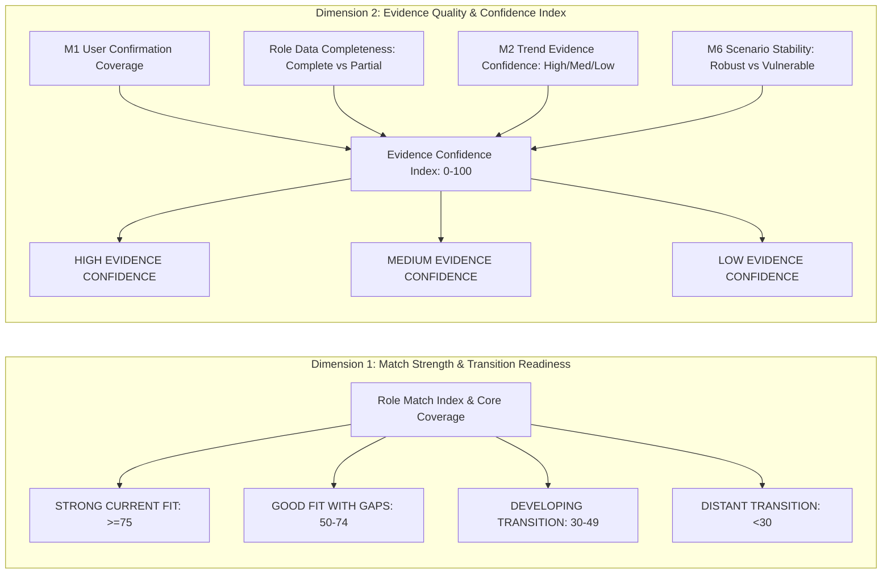

# M3 Recommendation Confidence & Label Semantics Forensic Audit

**Audit Target**: Match Index Interpretation, Confidence Labels, and Epistemic Quality Separation  
**Date**: 2026-10-23  
**Auditor**: Senior Recommender-Systems Methodologist & Explainable-AI Auditor  
**Audit Finding**: **`P1 DEFECT IDENTIFIED — MATCH STRENGTH AND EVIDENCE CONFIDENCE ARE CONFLATED`**  

---

## 1. Executive Summary & Defect Finding (Audits 10 & 11)

A cardinal principle of trustworthy explainable AI in high-stakes domain applications is:  
> **"Match Strength" (how well a candidate's skills align with a role) is fundamentally orthogonal to "Evidence Confidence" (how reliable, complete, and certain the underlying data and mappings are).**

Our forensic audit revealed that M3 v1.0.0 completely conflated these two distinct constructs.

### The Problematic Code in `src/role_matching_engine.py`:
```python
# Lines 254-262 in src/role_matching_engine.py
if final_index >= 75.0 and gaps["core_coverage_pct"] >= 75.0:
    rec_confidence = "HIGH CONFIDENCE FIT"
elif final_index >= 50.0 and gaps["core_coverage_pct"] >= 50.0:
    rec_confidence = "MODERATE FIT WITH GAP"
elif final_index >= 30.0:
    rec_confidence = "DEVELOPING TRANSITION TARGET"
else:
    rec_confidence = "DISTANT TRANSITION"
```

### Forensic Proof of Defect:
1. **False High Confidence on Low-Quality Data**: Occupation `2519 Software Developers NEC` carries `data_completeness == "PARTIAL"` and `mapping_confidence == "MEDIUM"`. Yet, when evaluated against Persona 2 (Software Developer), the engine output `recommendation_confidence: "HIGH CONFIDENCE FIT"` purely because its numerical score was $78.2 \ge 75.0$.
2. **False Low Confidence on High-Quality Data**: Occupation `2143 Environmental Engineers` has `data_completeness == "COMPLETE"`, `mapping_confidence == "HIGH"`, direct Bursa Malaysia statutory grounding, and `HIGH` M2 confidence. Yet, when evaluated against Persona 2 (who has no green skills), it output `recommendation_confidence: "DISTANT TRANSITION"`, conveying an erroneous impression of low data confidence when in reality it was simply a distant skill fit on rock-solid evidence.
3. **Audit Determination**: **`MATCH/CONFIDENCE CONFLATED (P1 DEFECT)`**.

---

## 2. Decoupled Semantic Architecture (Required Remediation)

To remediate P1-1, Stage 11C must split the single conflated label into two independent, orthogonal outputs:



---

## 3. Orthogonal Category Matrix

Under the remediated architecture, all four quadrants of the match-confidence plane become expressible and interpretable:

| Match Strength \ Evidence Quality | HIGH Evidence Confidence | MEDIUM Evidence Confidence | LOW Evidence Confidence |
|:---|:---|:---|:---|
| **STRONG CURRENT FIT** ($\ge 75$) | **Ideal Immediate Match**: High skill alignment grounded in complete direct Malaysian evidence. *(e.g. Persona 2 $\rightarrow$ MASCO 2512)* | **Plausible Fit with Data Gap**: High skill fit, but role uses proxy crosswalk or partial completeness. *(e.g. Persona 2 $\rightarrow$ MASCO 2519)* | **Speculative Strong Fit**: High nominal overlap, but source data is stale or low sample. Must warn user. |
| **GOOD FIT WITH GAPS** ($50–74$) | **Reliable Upskilling Target**: Actionable transition where skill gaps and labor demand are verified. *(e.g. Persona 1 $\rightarrow$ MASCO 2521)* | **Moderate Fit with Proxy Baseline**: Emerging specialization with moderate transition distance. | **Uncertain Moderate Target**: High uncertainty in labor shortage or scenario projection. |
| **DEVELOPING TRANSITION** ($30–49$) | **Reliable Long-Term Roadmap**: Early-career candidate targeting verified high-shortage role. *(e.g. Persona 8 $\rightarrow$ MASCO 4110)* | **Developing Transition (Proxy Data)**: Candidate has entry skills for an emerging associate role. | **Exploratory Transition**: Sparse profile targeting specialized role. |
| **DISTANT TRANSITION** ($< 30$) | **Certain Mismatch**: We are highly confident that the candidate currently lacks prerequisite skills. *(e.g. Persona 2 $\rightarrow$ MASCO 2143)* | **Probable Mismatch**: Low skill alignment on proxy-mapped role. | **Distant / Insufficient Data**: Unrelated domain with sparse data. |

---

## 4. Remediation Formulation for Stage 11C

### A. Rename Match Categories:
- `final_index >= 75.0` $\implies$ **`STRONG CURRENT FIT`**
- `50.0 <= final_index < 75.0` $\implies$ **`GOOD FIT WITH GAPS`**
- `30.0 <= final_index < 50.0` $\implies$ **`DEVELOPING TRANSITION TARGET`**
- `final_index < 30.0` $\implies$ **`DISTANT TRANSITION`**

### B. Implement Independent Evidence Confidence Formulation ($E_{\text{conf}} \in [0, 100]$):
$$E_{\text{conf}} = 0.35 \cdot C_{\text{user}} + 0.25 \cdot C_{\text{req}} + 0.25 \cdot C_{\text{M2}} + 0.15 \cdot C_{\text{M6}}$$
where:
- $C_{\text{user}}$: Ratio of profile skills that are `USER_CONFIRMED` or `USER_ADDED` (vs unverified suggestions).
- $C_{\text{req}}$: $100$ for `COMPLETE`, $70$ for `PARTIAL`, $40$ for `SPARSE`.
- $C_{\text{M2}}$: M2 confidence index ($100$ for HIGH, $75$ for MEDIUM, $50$ for LOW).
- $C_{\text{M6}}$: $100$ for `ROBUST_RESILIENT`, $70$ for `VULNERABLE`.

Categorical Evidence Label:
- $E_{\text{conf}} \ge 80 \implies$ **`HIGH EVIDENCE CONFIDENCE`**
- $60 \le E_{\text{conf}} < 80 \implies$ **`MEDIUM EVIDENCE CONFIDENCE`**
- $E_{\text{conf}} < 60 \implies$ **`LOW EVIDENCE CONFIDENCE`**
