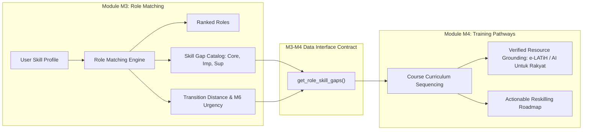

# M3–M4 Downstream Interface & Consumption Specification

**Interface Version**: 1.0.0  
**Upstream Provider**: M3 Explainable Future-Role Matching Engine  
**Downstream Consumer**: M4 Training Pathways & Learning Recommender  
**Contract Status**: `CERTIFIED & SAFE FOR M4 CONSUMPTION`  
**Date**: 2026-10-23  

---

## 1. Architectural Boundary & Separation of Concerns

The division of responsibility between Module M3 and Module M4 is strictly demarcated:
- **Module M3 (Role Matching)**: Analyzes worker skills against empirical role requirements, calculates the `ROLE_MATCH_INDEX`, determines transition distance, and produces the structured skill gap catalog.
- **Module M4 (Training Pathways)**: Consumes the skill gap catalog from M3 and sequences verified, real-world educational resources (e-LATiH, AI Untuk Rakyat, MDEC, tertiary courses) into actionable reskilling roadmaps.



---

## 2. Binding Consumption Rules for M4

### Rule 1: Priority-Ordered Course Sequencing
M4 must sequence courses based strictly on skill requirement strength:
1. **Tier 1 (Immediate)**: Skills classified under `missing_core_skills` must be placed at Stage 1 of the pathway. A user cannot achieve role readiness without resolving core requirements.
2. **Tier 2 (Progressive)**: Skills under `missing_important_skills` form Stage 2.
3. **Tier 3 (Elective / Advanced)**: Skills under `missing_supporting_skills` form Stage 3.

### Rule 2: Non-Punitive Clerical Bridging
For clerical occupations facing high automation pressure (`4110 General Office Clerks`, `4311 Accounting Clerks`, `3343 Secretaries`):
- M4 must **never present dead-end messages**.
- M4 must recommend adjacent high-leverage digital competencies (`workflow_automation`, `process_mapping`, `sql_data_analysis`, `data_privacy_pdpa`) that bridge workers toward emerging managerial and technical advisory careers (`2511 Systems Analysts`, `2421 Management Analysts`).

### Rule 3: Reskilling Urgency Pacing
M4 consumes `reskilling_urgency` (`LOW`, `MODERATE`, `HIGH`, `VERY HIGH`) from M6:
- **`VERY HIGH`**: Flags the pathway with a "Priority Transition" indicator, recommending accelerated modular learning.
- **Safety Restriction**: Urgency must **NOT dictate mandatory legal training hours, minimum course fees, or artificially inflated workload**.

### Rule 4: Zero Hallucination Course Grounding
In accordance with competition rules:
- M4 must only recommend real, verified Malaysian national courses (e.g. AI Untuk Rakyat via MyDIGITAL, HRD Corp e-LATiH portal, MDEC Digital Academy).
- M4 must **never invent fake course titles, commercial pricing, or fabricated university certificates**.

---

## 3. Python Integration Snippet for M4 Callers

```python
from src.role_matching_engine import RoleMatchingEngine

engine = RoleMatchingEngine()

# Step 1: User selects target career from M3 recommendation list
target_role = "2511"  # Systems Analysts

# Step 2: Fetch structured skill gaps from M3
gaps = engine.get_role_skill_gaps(user_profile, target_role)

# Step 3: Fetch scenario context from M3 match
match_details = engine.get_role_match(user_profile, target_role, scenario_id="FAST_AGENTIC")

# Step 4: M4 consumes gap arrays for curriculum generation
core_gaps = [g["skill_id"] for g in gaps["missing_core_skills"]]
important_gaps = [g["skill_id"] for g in gaps["missing_important_skills"]]
urgency = match_details["components"]["m6_reskilling_urgency"]
transition_tier = gaps["transition_distance"]

# M4 sequences core_gaps first, paced by urgency and transition_tier
```
