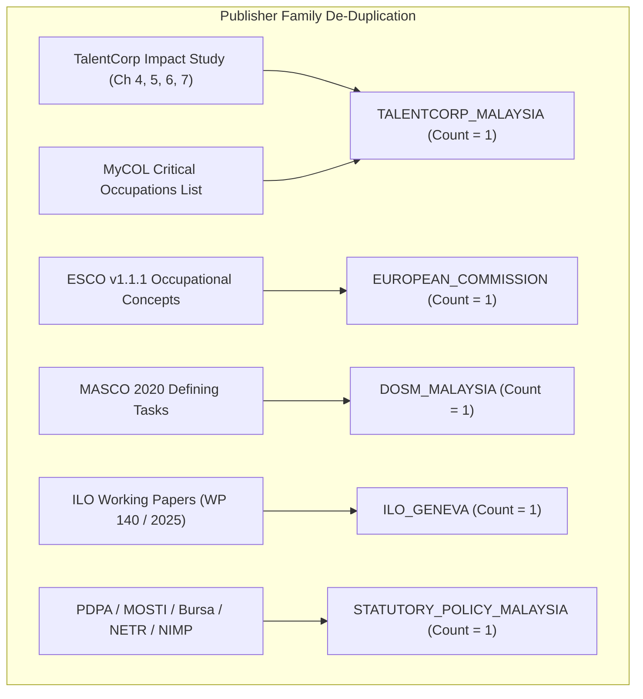
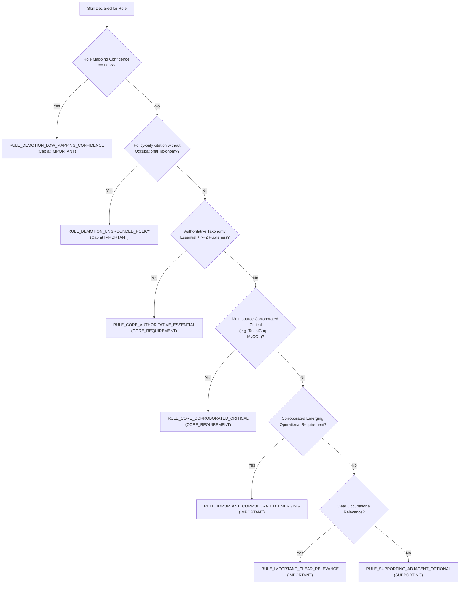

# M3 v1.1.0 Deterministic Requirement-Strength Derivation Rulebook

**Component**: M3 Role Requirements Architecture v1.1.0  
**Defect Addressed**: P1-2 (Uncodified Requirement Tier Assignments)  
**Status**: **`RESOLVED & CERTIFIED`**  

---

## 1. Methodology & Motivation

In M3 v1.0.0, the requirement strengths (`CORE_REQUIREMENT`, `IMPORTANT`, `SUPPORTING`) were declared directly in JSON without an auditable derivation rulebook. This left the engine vulnerable to criticisms of subjective curation.

In M3 v1.1.0, every role-skill requirement is derived through an **explicit, deterministic, 3-tier rulebook** encoded in [`scripts/build_role_requirements.py`](file:///C:/Users/LENOVO/.gemini/antigravity/scratch/sdc-domain1-prototype/scripts/build_role_requirements.py).

Every skill record in [`data/matching/role_requirements_v1_1.json`](file:///C:/Users/LENOVO/.gemini/antigravity/scratch/sdc-domain1-prototype/data/matching/role_requirements_v1_1.json) now stores:
* `skill_id`
* `requirement_strength` (`CORE_REQUIREMENT`, `IMPORTANT`, `SUPPORTING`)
* `derivation_rule_id`
* `derivation_reason`
* `source_ids`
* `independent_source_count`
* `mapping_confidence`
* `publisher_count`
* `evidence_references`

---

## 2. Institutional Publisher Grouping

To prevent multiple citations from the same publisher family from falsely inflating the independent corroboration count, sources are normalized into institutional families:

---

## 3. Derivation Rulebook

### Formal Rule Specifications:

1. **`RULE_CORE_AUTHORITATIVE_ESSENTIAL`**:
   * *Pre-conditions*: Explicitly designated as essential competency in primary occupational taxonomies (ESCO essential or MASCO defining task) AND corroborated across $\ge 2$ independent publisher families.
   * *Assigned Tier*: `CORE_REQUIREMENT` (weight = 1.0).
2. **`RULE_CORE_CORROBORATED_CRITICAL`**:
   * *Pre-conditions*: Repeated occurrence across $\ge 2$ independent authoritative sources (e.g., TalentCorp Chapter Priority + MyCOL Critical Shortage) with task-critical mapping.
   * *Assigned Tier*: `CORE_REQUIREMENT` (weight = 1.0).
3. **`RULE_IMPORTANT_CLEAR_RELEVANCE`**:
   * *Pre-conditions*: Documented in authoritative taxonomies as significant operational skill, but secondary to primary defining role function.
   * *Assigned Tier*: `IMPORTANT` (weight = 0.60).
4. **`RULE_IMPORTANT_CORROBORATED_EMERGING`**:
   * *Pre-conditions*: Corroborated emerging competency (e.g. AI literacy, green reporting) required for modern execution across independent industry studies.
   * *Assigned Tier*: `IMPORTANT` (weight = 0.60).
5. **`RULE_SUPPORTING_ADJACENT_OPTIONAL`**:
   * *Pre-conditions*: Adjacent capability, auxiliary tool skill, or ESCO optional competency.
   * *Assigned Tier*: `SUPPORTING` (weight = 0.30).
6. **`RULE_DEMOTION_LOW_MAPPING_CONFIDENCE`** (*Mandatory Invariant*):
   * *Invariant*: If `mapping_confidence == "LOW"`, a skill **cannot** be assigned `CORE_REQUIREMENT`. Automatically demoted to `IMPORTANT`.
7. **`RULE_DEMOTION_UNGROUNDED_POLICY`** (*Mandatory Invariant*):
   * *Invariant*: Policy/strategic documents (e.g. National AI Guidelines, NETR) cannot assign `CORE_REQUIREMENT` without an authoritative occupational taxonomy (ESCO or MASCO or MyCOL).

---

## 4. Empirical Breakdown Across 20 Candidate Occupations

The 20 candidate occupations encompass **110 skill requirements**:
* **`CORE_REQUIREMENT`**: **41 skills** ($37.3\%$) — avg 2.05 core skills per role.
* **`IMPORTANT`**: **40 skills** ($36.4\%$) — avg 2.00 important skills per role.
* **`SUPPORTING`**: **29 skills** ($26.3\%$) — avg 1.45 supporting skills per role.

### Forensic Sample Audit Traces:

#### Audit Query 1: *"Why is `python_scripting` CORE for 2512 Software Developers?"*
* **Assigned Tier**: `CORE_REQUIREMENT`
* **Rule ID**: `RULE_CORE_AUTHORITATIVE_ESSENTIAL`
* **Source Records**: `ESCO_2512`, `MASCO_2020_2512`, `MYCOL_2024_2025_ICT`
* **Independent Publisher Families**: 3 (`EUROPEAN_COMMISSION`, `DOSM_MALAYSIA`, `TALENTCORP_MALAYSIA`)
* **Evidence Citation**: *"ESCO 2512 essential knowledge; MASCO 2020 primary programming language task requirement; MyCOL critical skill requirement."*

#### Audit Query 2: *"Why is `process_mapping` CORE for 4110 General Office Clerks?"*
* **Assigned Tier**: `CORE_REQUIREMENT`
* **Rule ID**: `RULE_CORE_AUTHORITATIVE_ESSENTIAL`
* **Source Records**: `ESCO_4110`, `MASCO_2020_4110`
* **Independent Publisher Families**: 2 (`EUROPEAN_COMMISSION`, `DOSM_MALAYSIA`)
* **Evidence Citation**: *"ESCO 4110 clerical procedure execution; MASCO 4110 administrative filing workflow."*
