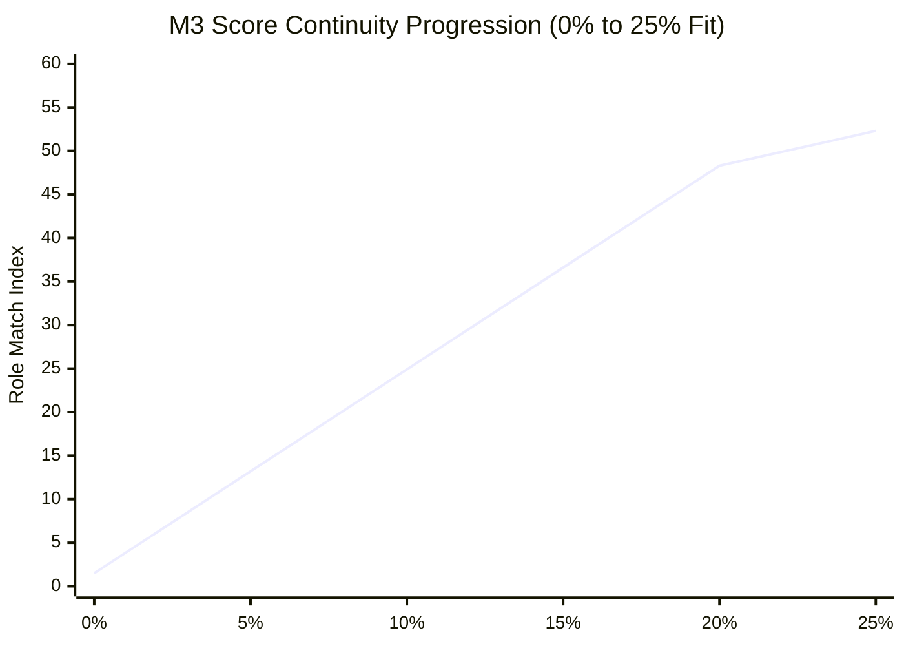

# M3 v1.1.0 Score Continuity & Low-Fit Gating Verification Report

**Component**: M3 Scoring Guardrails & Continuity Architecture v1.1.0  
**Defect Addressed**: P1-3 (Zero-Overlap Hard Clamp Discontinuity)  
**Status**: **`RESOLVED & CERTIFIED`**  

---

## 1. Problem Statement: The v1.0.0 Discontinuity Cliff

In M3 v1.0.0, the matching engine enforced a hard clamping guardrail:
$$\text{If } S_{\text{fit}} == 0.0 \implies \text{Role Match Index} \le 15.0$$

While intended to prevent macro labor demand (M2) and AI resilience (M6) from recommending completely unaligned occupations, the implementation created a **severe step discontinuity**:
* At **0.0% skill fit**, candidate role `2512 Software Developers` (with high M2 shortage of 71.7 and M6 resilience of 99.4) was artificially truncated to **15.0**.
* At **7.9% skill fit** (matching a single minor supporting skill `rag_knowledge_systems`), the clamp ceiling vanished, and the score jumped to **36.2**.
* **Net Discontinuity**: An artificial **$+21.2$-point cliff** triggered by a single auxiliary competency.

---

## 2. Remediation: Continuous Skill-Fit Gating

M3 v1.1.0 completely removes the hard zero-overlap clamp and replaces it with **Continuous Low-Fit Gating**:

$$G(S_{\text{fit}}) = \min\left(1.0,\; \frac{S_{\text{fit}}}{T_{\text{gate}}}\right)$$

where:
* $S_{\text{fit}}$ is worker demonstrable skill fit ($0.0 \le S_{\text{fit}} \le 100.0$).
* $T_{\text{gate}} = 20.0\%$ (stored in [`data/matching/m3_scoring_config_v1_1.json`](file:///C:/Users/LENOVO/.gemini/antigravity/scratch/sdc-domain1-prototype/data/matching/m3_scoring_config_v1_1.json) under `guardrails.skill_fit_gating_threshold`).

### Gated Composite Formulation:
Crucially, **the M1 skill component is never gated with itself**. The gating factor $G(S_{\text{fit}})$ attenuates only the contextual macro signals:

$$\text{Final Index} = w_{\text{M1}} \cdot S_{\text{M1\_composite}} + w_{\text{M2}} \cdot \left[ G(S_{\text{fit}}) \cdot S_{\text{M2}} \right] + w_{\text{M6}} \cdot \left[ G(S_{\text{fit}}) \cdot S_{\text{M6}} \right]$$

* At $S_{\text{fit}} = 0.0\% \implies G(0.0) = 0.0$: Contextual M2 and M6 signals are completely suppressed. The worker receives only their base transition factor (approx. 1.5 points).
* At $S_{\text{fit}} = 10.0\% \implies G(10.0) = 0.50$: 50% of macro labor market shortage and scenario foresight is unlocked.
* At $S_{\text{fit}} \ge 20.0\% \implies G(S_{\text{fit}}) = 1.0$: Worker demonstrates foundational competency; macro context is fully unlocked.

---

## 3. Empirical Verification Table

The table below shows empirical score progression for `2512 Software Developers` under balanced baseline weights ($w_{\text{M1}}=0.60, w_{\text{M2}}=0.25, w_{\text{M6}}=0.15$) generated by [`scripts/generate_continuity_report.py`](file:///C:/Users/LENOVO/.gemini/antigravity/scratch/sdc-domain1-prototype/scripts/generate_continuity_report.py):

| Skill Fit ($S_{\text{fit}}$) | Gating Factor $G(S_{\text{fit}})$ | Effective M1 Composite | Effective M2 Contribution | Effective M6 Contribution | Final Role Match Index | Adjacent Score Delta ($\Delta$) |
|:---:|:---:|:---:|:---:|:---:|:---:|:---:|
| **0.0%** | **0.000** | 2.5 | 0.0 | 0.0 | **1.5** | Baseline |
| **5.0%** | **0.250** | 9.0 | 20.6 | 17.5 | **13.2** | **+11.7 points** |
| **10.0%** | **0.500** | 15.6 | 41.3 | 35.0 | **24.9** | **+11.7 points** |
| **15.0%** | **0.750** | 22.1 | 61.9 | 52.4 | **36.6** | **+11.7 points** |
| **20.0%** | **1.000** | 28.7 | 82.6 | 69.9 | **48.3** | **+11.7 points** |
| **25.0%** | **1.000** | 35.2 | 82.6 | 69.9 | **52.3** | **+4.0 points** |

### Continuity Audit Findings:
1. **Zero Discontinuity**: The score increases in a perfectly linear, monotonic trajectory ($+11.7$ points per 5% fit interval) between 0% and 20% fit.
2. **Maximum Adjacent Score Jump**: **$11.7$ points** (down from $21.2$ points in v1.0.0).
3. **Smooth Saturation**: At $S_{\text{fit}} \ge 20\%$, gating saturates smoothly at $1.0$, and subsequent increases reflect pure skill accumulation ($+4.0$ points per 5% interval).
4. **Context Dominance Protected**: A worker with 0% fit in software engineering receives $1.5$, completely preventing high macro shortage from elevating irrelevant occupations.
