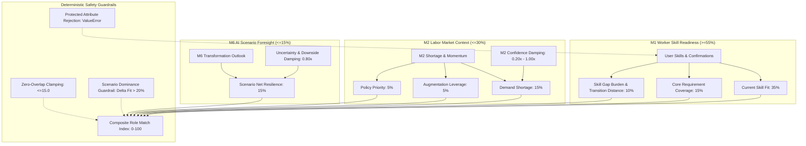

# M3 Role Matching Scoring Methodology & Mathematical Architecture

**Version**: M3 v1.0.0  
**Engine Architecture**: Explainable Multi-Component Recommender with Multi-Scenario Foresight  
**Downstream Safety Compliance**: Certified compliant with M6 Downstream Safety Contract ([`artifacts/m6_downstream_contract_final.md`](file:///C:/Users/LENOVO/.gemini/antigravity/scratch/sdc-domain1-prototype/artifacts/m6_downstream_contract_final.md))  
**Date**: 2026-10-23  

---

## 1. Architectural Principles

The M3 Matching Engine rejects opaque "black-box" similarity matrices (e.g. unconstrained vector embeddings or cosine distances) in favor of **inspectable, decomposed multi-channel scoring**:

1. **Skill-First Primacy**: Demonstrable worker skill readiness must always constitute the primary matching anchor ($w_{\text{M1}} \ge 55\%$). Macro shortage or AI scenario enthusiasm must never override demonstrable skill mismatch.
2. **Bounded External Channels**: Empirical labor shortage momentum from M2 is strictly capped at $w_{\text{M2}} \le 30\%$, and forward-looking exploratory AI scenario impact from M6 is strictly capped at $w_{\text{M6}} \le 15\%$.
3. **Metric Semantics**: The primary score output is the **`ROLE_MATCH_INDEX`** ($0–100$). It is an index of competency alignment and transition viability, **explicitly NOT a probability of hiring or future employment success**.
4. **User Override Primacy**: Inferred skills from M1 are suggestions. Explicit user actions strictly override model inferences.

---

## 2. Decomposed Scoring Components

---

## 3. Mathematical Formulation

### 3.1. User Skill Crediting & Override Hierarchy
For any skill $s$ evaluated against user profile $U$:
$$C(s) = \begin{cases} 
1.0 & \text{if } s \in \text{USER\_CONFIRMED} \cup \text{USER\_ADDED} \\
0.85 & \text{if } s \in \text{M1\_CORE and } s \notin \text{DISMISSED} \\
0.50 & \text{if } s \in \text{M1\_SUGGESTED and } s \notin \text{DISMISSED} \\
0.0 & \text{if } s \in \text{DISMISSED} \cup \text{ABSENT}
\end{cases}$$

### 3.2. Component 1: Current Skill Fit ($S_{\text{fit}} \in [0, 100]$)
Let $W_r(s)$ be the weight of skill $s$ for candidate role $r$:
- $W_r(s) = 1.0$ for `CORE_REQUIREMENT`
- $W_r(s) = 0.60$ for `IMPORTANT`
- $W_r(s) = 0.30$ for `SUPPORTING`

$$S_{\text{fit}}(U, r) = \frac{\sum_{s \in \text{req}(r)} W_r(s) \cdot C(s)}{\sum_{s \in \text{req}(r)} W_r(s)} \times 100$$

### 3.3. Component 2: Core Requirement Coverage ($S_{\text{core}} \in [0, 100]$)
A core requirement $s$ is matched if $C(s) \ge 0.50$:
$$S_{\text{core}}(U, r) = \frac{\sum_{s \in \text{Core}(r)} \mathbb{I}(C(s) \ge 0.50)}{|\text{Core}(r)|} \times 100$$

### 3.4. Component 3 & 4: Skill Gap Burden & Transition Distance ($S_{\text{gap\_trans}} \in [0, 100]$)
Missing skills are categorized into:
- $\text{Gap}_{\text{core}} = \{s \in \text{Core}(r) \mid C(s) < 0.50\}$
- $\text{Gap}_{\text{imp}} = \{s \in \text{Important}(r) \mid C(s) < 0.50\}$
- $\text{Gap}_{\text{sup}} = \{s \in \text{Supporting}(r) \mid C(s) < 0.50\}$

$$\text{Gap Penalty} = 1.0 \cdot |\text{Gap}_{\text{core}}| + 0.50 \cdot |\text{Gap}_{\text{imp}}| + 0.20 \cdot |\text{Gap}_{\text{sup}}|$$

Transition distance is determined deterministically:
- **`SHORT TRANSITION`** ($F_{\text{trans}} = 1.00$): $S_{\text{core}} \ge 75\%$ AND $|\text{Gap}_{\text{core}}| \le 1$
- **`MODERATE TRANSITION`** ($F_{\text{trans}} = 0.75$): $S_{\text{core}} \ge 50\%$ AND $|\text{Gap}_{\text{core}}| \le 2$
- **`SUBSTANTIAL TRANSITION`** ($F_{\text{trans}} = 0.45$): $S_{\text{core}} \ge 25\%$ OR $|\text{Gap}_{\text{core}}| \le 3$
- **`LONG TRANSITION`** ($F_{\text{trans}} = 0.15$): otherwise

$$S_{\text{gap\_trans}}(U, r) = F_{\text{trans}} \times \max(0, 100 - 15 \times \text{Gap Penalty})$$

### 3.5. Component 5 & 6: M2 Labor-Market Context ($M2_{\text{score}} \in [0, 100]$)
$$M2_{\text{raw}} = \frac{0.15 \cdot D_{\text{short}} + 0.05 \cdot A_{\text{aug}} + 0.05 \cdot P_{\text{pol}}}{0.25}$$
$$M2_{\text{score}} = M2_{\text{raw}} \times F_{\text{conf}}$$
where $F_{\text{conf}}$ is $1.0$ (HIGH), $0.80$ (MEDIUM), $0.50$ (LOW), or $0.20$ (INSUFFICIENT).

### 3.6. Component 7 & 8: M6 Scenario Context ($M6_{\text{score}} \in [0, 100]$)
$$\text{Net Resilience} = 0.50 \cdot R_{\text{res}} + 0.30 \cdot O_{\text{aug}} + 0.20 \cdot (100 - T_{\text{pres}})$$
$$M6_{\text{score}} = \text{Net Resilience} \times D_{\text{sc}}$$
where $D_{\text{sc}} = 0.80$ if scenario confidence is `MEDIUM` or downside stability is `VULNERABLE`, otherwise $1.0$.

### 3.7. Composite Role Match Index & Safety Guardrails
$$\text{Raw } RMI = w_{\text{M1}} \cdot M1_{\text{composite}} + w_{\text{M2}} \cdot M2_{\text{score}} + w_{\text{M6}} \cdot M6_{\text{score}}$$

**Guardrail 1: Zero-Overlap Clamping**:
$$\text{If } S_{\text{fit}}(U, r) == 0.0 \implies RMI = \min(RMI, 15.0)$$

**Guardrail 2: Scenario Dominance Guardrail**:
$$\text{If } S_{\text{fit}}(U, A) - S_{\text{fit}}(U, B) > 20.0 \implies \text{Rank}(A) < \text{Rank}(B)$$
An inferior skill-fit role cannot outrank a role with $>20\%$ superior skill fit, regardless of how high its M2 or M6 score is.

---

## 4. Weight Configurations Matrix

| Parameter / Weight | Balanced Baseline | Skill-Heavy | Scenario-Aware | Safety Contract Limit |
|:---|:---:|:---:|:---:|:---:|
| **Total M1 (Worker Skill Readiness)** | **0.60 (60%)** | **0.75 (75%)** | **0.55 (55%)** | **$\ge 0.55$ (Min 55%)** |
| - Current Skill Fit | 0.35 | 0.45 | 0.30 | - |
| - Core Requirement Coverage | 0.15 | 0.18 | 0.15 | - |
| - Gap Burden & Transition Distance | 0.10 | 0.12 | 0.10 | - |
| **Total M2 (Labor Market Context)** | **0.25 (25%)** | **0.15 (15%)** | **0.30 (30%)** | **$\le 0.30$ (Max 30%)** |
| - Demand Shortage Momentum | 0.15 | 0.09 | 0.18 | - |
| - Augmentation Leverage | 0.05 | 0.03 | 0.06 | - |
| - Policy Priority | 0.05 | 0.03 | 0.06 | - |
| **Total M6 (Scenario Context)** | **0.15 (15%)** | **0.10 (10%)** | **0.15 (15%)** | **$\le 0.15$ (Max 15%)** |
| - Scenario Net Resilience | 0.15 | 0.10 | 0.15 | - |
| **Sum of Weights** | **1.00** | **1.00** | **1.00** | **1.00** |
