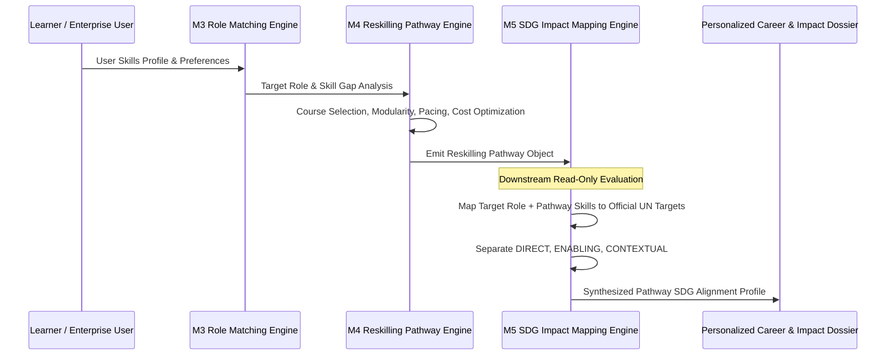

# M4-to-M5 Pathway SDG Mapping Interface Contract

**System:** M5 SDG Impact Mapping Engine v1.0.0  
**Stage:** Stage 13A Architecture & Mapping  
**Date:** 2026-10-24  
**Author:** Senior Learning-Pathway Engineer, Recommender-Systems Methodologist  
**Artifact Referenced:** `src/sdg_impact_engine.py`, `data/sdg/m5_config_v1.json`

---

## 1. Architectural Relationship & Data Flow

M5 serves as an **explanatory downstream analytics module** for M4 (Personalised Reskilling Pathway Engine). The interaction between M4 and M5 follows a strictly unidirectional, decoupled data contract:



---

## 2. Ingestion Input Contract

M5 accepts an M4 pathway JSON payload conforming to either the compact or full M4 pathway schema.

### Supported Input Schema:
```json
{
  "pathway_id": "string (required, e.g. 'PATH_2512_RESKILLING')",
  "target_role_code": "string (required, 4-digit MASCO e.g. '2512')",
  "skills": ["string (list of canonical skill IDs, optional)"],
  "modules": [
    {
      "module_id": "string",
      "skill_id": "string (canonical skill ID)",
      "skills_covered": ["string"]
    }
  ],
  "gap_skills": ["string (list of canonical skill IDs, optional)"]
}
```

---

## 3. Emitted Output Contract

The `map_pathway_to_sdgs` API returns an enriched, structured SDG impact report:

### Output Schema:
```json
{
  "pathway_id": "string",
  "target_role_code": "string",
  "target_role_title": "string",
  "skills_analyzed_count": "integer",
  "skills_analyzed": ["string"],
  "total_sdgs_aligned": "integer",
  "direct_sdgs": ["integer (list of SDG numbers with DIRECT impact)"],
  "enabling_sdgs": ["integer (list of SDG numbers with ENABLING impact)"],
  "contextual_sdgs": ["integer (list of SDG numbers with CONTEXTUAL impact)"],
  "sdg_alignments": [
    {
      "sdg_id": "integer",
      "sdg_name": "string",
      "overall_mapping_type": "DIRECT | ENABLING | CONTEXTUAL",
      "targets_addressed": ["string (e.g. '13.2', '9.5')"],
      "contributing_skills": ["string"],
      "role_aligned": "boolean",
      "direct_contributions_count": "integer",
      "enabling_contributions_count": "integer",
      "contextual_contributions_count": "integer",
      "contributions": [
        {
          "source_type": "SKILL | ROLE",
          "source_id": "string",
          "source_title": "string",
          "target_id": "string",
          "target_description": "string",
          "mapping_type": "DIRECT | ENABLING | CONTEXTUAL",
          "alignment_strength": "STRONG | MODERATE | LIMITED",
          "contribution_pathway": "string",
          "evidence_references": "string"
        }
      ]
    }
  ],
  "pathway_impact_narrative": "string (qualitative narrative synthesis)",
  "methodology_disclaimer": "string (mandatory anti-hallucination and non-feedback statement)"
}
```

---

## 4. Guardrail Protections & Isolation Invariants

To prevent perverse incentives and algorithmic gaming:
1. **No Re-ranking of M4 Recommendations:** M4 course recommendations are never ordered or boosted by their SDG score. Courses are chosen purely on pedagogical quality, cost, time, and skill gap coverage.
2. **No Role Gatekeeping in M3:** A user exploring an accounting or software career is never penalized because their selected pathway does not contain agricultural or marine goals.
3. **No Synthetic Metric Generation:** The engine rejects any logic calculating fake carbon offset kilograms or estimated numbers of jobs created.
4. **Mandatory Disclaimer:** Every pathway report must contain the unedited methodology disclaimer:
   > *"M5 SDG impact mapping represents qualitative and structural policy alignment grounded in the official UN 2030 indicator framework. M5 does NOT produce synthetic quantitative measurements (such as metric tons of CO2 avoided or direct jobs generated). M5 operates as a downstream analytical lens and does not alter, bias, or restrict M3 role matching or M4 course recommendations."*

---

## 5. Contract Status

- **Status:** **FROZEN CANDIDATE FOR STAGE 13B**.
- **Backward Compatibility:** 100% compatible with M4 Personalised Reskilling Pathway Engine v1.1.0 outputs.
