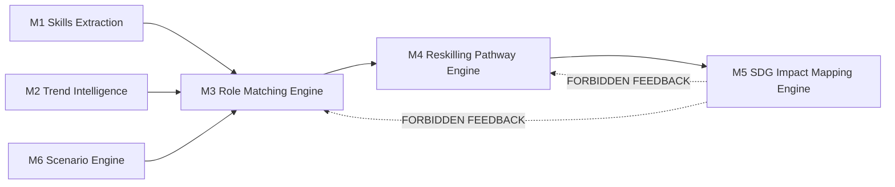

# M5 SDG Impact Mapping Methodology

**System:** M5 SDG Impact Mapping Engine v1.0.0  
**Stage:** Stage 13A Architecture & Mapping  
**Date:** 2026-10-24  
**Author:** Senior Sustainability Data Architect, SDG Taxonomy Researcher, Workforce-Impact Methodologist  
**Status:** COMPLETE (Candidate for Stage 13B Methodology Review)

---

## 1. Executive Summary & Purpose

The **M5 SDG Impact Mapping Engine** establishes an evidence-grounded, policy-traceable taxonomy mapping framework connecting workforce competencies (16 canonical skills), occupational structures (20 MASCO 4-digit occupations), and personalised reskilling pathways (M4) to the **United Nations 2030 Agenda for Sustainable Development (17 Sustainable Development Goals, 169 Targets)**.

The core purpose of M5 is **alignment, transparency, and narrative grounding**, not speculative quantitative impact claims. M5 provides an analytical lens to help learners, educational institutions, enterprise leaders, and policy authorities understand how technological upskilling and career transitions contribute to national and global sustainability priorities.

---

## 2. Theoretical Foundations & Grounding

M5 is grounded in established international and national sustainability taxonomies:
1. **United Nations 2030 Agenda for Sustainable Development**: Resolution A/RES/70/1 adopted by the UN General Assembly in September 2015.
2. **UN Inter-Agency and Expert Group on SDG Indicators (IAEG-SDGs)**: Global indicator framework providing formal target definitions, indicators, and metadata.
3. **UNESCO Education for Sustainable Development (ESD) & TVET Competency Frameworks**: Identifying cognitive and technical capabilities required for just workforce transitions.
4. **International Labour Organization (ILO) Just Transition Guidelines**: Guidelines for a just transition towards environmentally sustainable economies and societies for all.
5. **Malaysian National Policy Frameworks**:
   - *National Energy Transition Roadmap (NETR)* (Ministry of Economy).
   - *New Industrial Master Plan 2030 (NIMP 2030)* (MITI - Mission 3: Pushing for Net Zero).
   - *National Artificial Intelligence Roadmap 2021-2025* (MOSTI).
   - *Bursa Malaysia Sustainability Reporting Guide (3rd Edition)*.
   - *Bursa Malaysia ESG Reporting Platform & IFRS S1/S2 Guidelines*.

---

## 3. Typology of SDG Alignments

To avoid generic over-claiming, M5 categorizes all alignments into three mutually exclusive **Mapping Types**:

| Mapping Type | Definition | Criteria & Governance | Examples |
| :--- | :--- | :--- | :--- |
| **DIRECT** | Inherent, primary, and domain-specific contribution to an SDG target. | The core capability or primary job task is explicitly described in or directly addresses the target text. | `carbon_footprint_analytics` $\to$ Target 13.2; `esg_sustainability_reporting` $\to$ Target 12.6; `2143 (Environmental Engineers)` $\to$ Target 13.2, 12.6, 11.6; `2151 (Electrical Engineers)` $\to$ Target 7.2. |
| **ENABLING** | Methodological, technological, or organizational capability empowering other domains to achieve the target. | The competency provides tools, infrastructure, data pipelines, or analysis essential for execution, but does not dictate the domain application itself. | `python_scripting` $\to$ Target 9.5; `sql_data_analysis` $\to$ Target 17.18; `workflow_automation` $\to$ Target 8.2; `2512 (Software Developers)` $\to$ Target 9.5, 8.2. |
| **CONTEXTUAL** | Secondary, administrative, or deployment-dependent alignment. | Contribution depends entirely on the operational setting, institutional policy, or industry environment where the role operates. | `4110 (General Office Clerks)` $\to$ Target 8.5; `3322 (Commercial Sales Representatives)` $\to$ Target 8.2; general office digitisation $\to$ Target 9.c. |

---

## 4. The General-Purpose Skill Rule (`RULE_GP_NON_DIRECT_STRICT`)

A critical scientific vulnerability in AI sustainability mapping is **impact inflation**—attributing direct climate or poverty mitigation to generic technical tools.

### Formal Rule Definition:
> *No general-purpose technological or computational skill may ever receive a `DIRECT` mapping to an SDG.*
> All general-purpose skills must default to `ENABLING` or `CONTEXTUAL`.

### Scope of Rule:
The following 5 skills are designated as **General-Purpose Skills**:
1. `python_scripting`
2. `sql_data_analysis`
3. `api_integration`
4. `prompt_engineering`
5. `workflow_automation`

### Rationale:
A Python script or SQL query can optimize an oil refinery's extraction efficiency (counter-SDG 13), execute high-frequency financial arbitrage (neutral), or calculate renewable microgrid dispatch (pro-SDG 7). Because the skill itself possesses zero intrinsic environmental directionality, designating Python or SQL as `DIRECT` SDG 13 is methodologically invalid. It is an **enabling tool**, not an impact outcome.

---

## 5. Architectural Guardrails: Strict Anti-Feedback Isolation

M5 operates downstream of M3 (Role Matching) and M4 (Personalised Reskilling Pathways). To protect algorithmic fairness, labor market utility, and educational integrity:

### Absolute Invariants:
1. **Zero Upstream Filtering**: M5 SDG scores and mappings NEVER filter, re-rank, or gate candidate roles in M3. A worker seeking an ICT role is never demoted because the role has "fewer" direct green SDGs than an environmental engineering role.
2. **Zero Course Distortion**: M4 course recommendations are based strictly on pedagogical quality, learning efficiency, cost, and skill gap coverage. M5 never re-ranks courses based on SDG badges.
3. **Zero Fabricated Quantifications**: M5 NEVER computes synthetic "kg CO2 saved", "jobs created", or "% SDG progress achieved". Such synthetic numbers are unverified, scientifically unsupportable, and deceptive to learners and employers.

---

## 6. Mathematical & Categorical Contract

M5 produces categorical and evidence-grounded alignment objects with the following schema:
- `sdg_id`: Integer $\in [1, 17]$.
- `target_id`: String matching official UN designation (e.g. `"13.2"`).
- `mapping_type`: Enum `["DIRECT", "ENABLING", "CONTEXTUAL"]`.
- `alignment_strength`: Enum `["STRONG", "MODERATE", "LIMITED"]`.
- `confidence`: Enum `["HIGH", "MEDIUM", "LOW"]`.
- `contribution_pathway`: Factual qualitative narrative describing the mechanism of action.
- `evidence_references`: Verifiable literature, policy, or institutional citations.
- `derivation_rule_id`: Machine-auditable rule identifier.

---

## 7. Version & Freeze Target

- **Current Version:** `1.0.0`
- **Target Freeze Date:** Following Stage 13D freeze verification.
- **Integrity Validation:** 11 unit tests passing, 8/8 automated benchmarks passing, 100% official target traceability.
