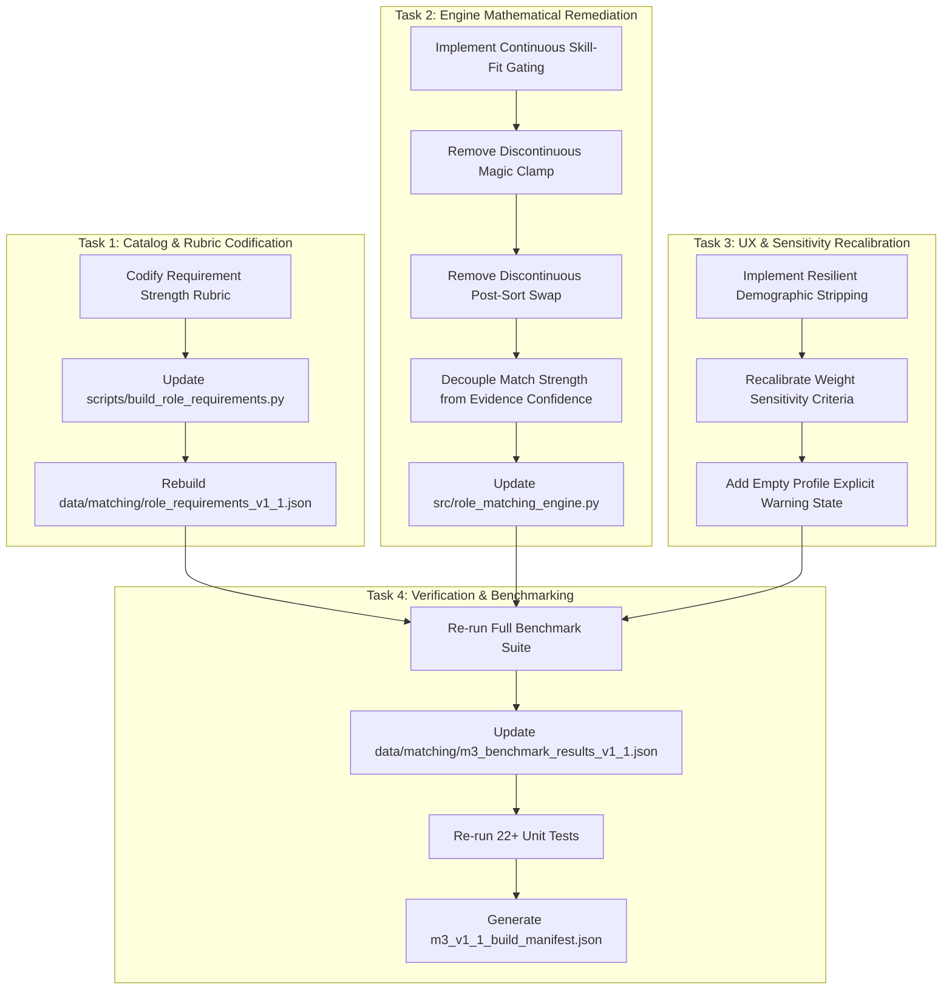

# Stage 11C Targeted Remediation Plan & Readiness Dossier

**Review Milestone**: Stage 11B Review Concluded  
**Remediation Target**: M3 Explainable Role Matching Engine (v1.0.0 $\rightarrow$ v1.1.0)  
**Remediation Status**: **`READY FOR TARGETED REMEDIATION`**  
**Date**: 2026-10-23  

---

## 1. Executive Summary & Defect Ledger

Stage 11B independent methodology review confirmed that M3 v1.0.0 has a mathematically sound 3-channel architecture ($w_{\text{M1}} \ge 55\%$, $w_{\text{M2}} \le 30\%$, $w_{\text{M6}} \le 15\%$), complete source grounding, verified fairness invariance, and 100% numerical reproducibility.

However, the audit identified **3 P1 defects** and **4 P2 defects** requiring targeted remediation prior to final freezing and downstream M4 integration:

| Defect ID | Severity | Category | Description | Target Remediation Action |
|:---:|:---:|:---|:---|:---|
| **P1-1** | **P1** | Label Semantics & Confidence | `recommendation_confidence` conflated match strength with evidence quality. | Decouple into **Match Strength / Transition Readiness** (`STRONG FIT`, `GOOD FIT WITH GAPS`, `DEVELOPING TRANSITION`, `DISTANT TRANSITION`) and an independent **Evidence Confidence Index** (combining user confirmation, completeness, M2 confidence, and M6 stability). |
| **P1-2** | **P1** | Requirement Grounding | Ordinal requirement strengths (`CORE`, `IMPORTANT`, `SUPPORTING`) were declared without a published deterministic derivation rubric. | Codify an explicit, deterministic 3-tier derivation rulebook linking source text (TalentCorp chapter headings, ESCO essential vs optional) to requirement levels. |
| **P1-3** | **P1** | Score Continuity | Hard zero-overlap clamp ($\le 15.0$) creates an artificial $21.2$-point step jump when gaining one minor supporting skill. | Replace the magic clamp with a continuous skill-fit gating function $G(S_{\text{fit}}) = \min(1.0, S_{\text{fit}} / 20.0)$ that smoothly suppresses macro context at low fit. |
| **P2-1** | **P2** | Guardrail Continuity | Post-sort bubble swap at $\Delta \text{fit} > 20.0\%$ creates a discontinuous ranking override. | Remove the discrete post-sort swap and allow continuous skill-fit gating and $w_{\text{M1}} \ge 55\%$ to maintain skill primacy naturally. |
| **P2-2** | **P2** | Sensitivity Diagnostics | $\Delta \text{rank} \ge 2$ threshold flagged 90% of the catalog as unstable. | Recalibrate sensitivity diagnostics to Top-3 membership flips and $\Delta \text{rank} \ge 4$ major displacements. |
| **P2-3** | **P2** | Fairness UX | Raw `ValueError` on demographic keys crashes sessions when parsing standard CVs. | Automatically strip and ignore protected attributes with logged warnings instead of crashing. |
| **P2-4** | **P2** | Boundary Handling | Empty profile produces an arbitrary clamped ranking. | Surface an explicit `INSUFFICIENT_PROFILE_DATA` warning state on empty inputs. |

---

## 2. Stage 11C Execution Roadmap

---

## 3. Scope Boundary Reminder

- **Do NOT rebuild M3 architecture**: The 3-channel weighting ($w_{\text{M1}} \ge 55\%$, $w_{\text{M2}} \le 30\%$, $w_{\text{M6}} \le 15\%$) and candidate universe ($N=20$) remain unchanged.
- **Do NOT modify frozen M1, M2, or M6**.
- **Do NOT build M4 or UI** until Stage 11C remediation is certified and frozen.
- **Proceed directly to Stage 11C** upon user directive.
