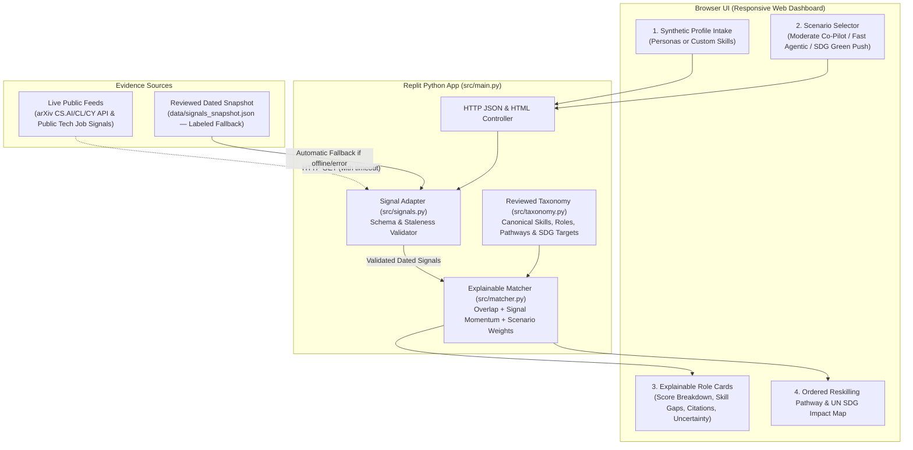

# AI Skills Compass — Prototype Specification (Prompt 1)

## 1. Structured Concept Debate

### Government (Pro-Concept Argument)
- **Direct Domain 1 Alignment**: **AI Skills Compass** directly answers Aiversecity's Domain 1 challenge brief (*"How might we build an AI-powered solution that continuously tracks AI advancement to predict which skills and jobs will emerge or decline, matches today's workforce and tomorrow's talent to the right future roles, and generates personalised reskilling pathways, while showing how each role and skill connects to the 17 UN Sustainable Development Goals?"*, Domain 1 Brief p. 2).
- **Rubric Fit — Innovation & Creativity (30%)**: Rather than building a generic *"upload a CV and ask a chatbot for jobs"* wrapper (explicitly penalized on p. 7 of the Domain 1 brief), AI Skills Compass anchors every role recommendation in **dated, inspectable AI research and job-market signals** (e.g., live arXiv CS.AI/CS.CY/CS.CL + RemoteOK/HN Who's Hiring tech job signals) mapped against a curated, auditable skill taxonomy. Users can toggle between **Moderate Adoption (Co-Pilot Era)** and **Fast Agentic Disruption** scenarios and watch role rankings, urgency scores, and SDG contributions shift deterministically.
- **Rubric Fit — Problem-Solution Fit (25%) & Feasibility (25%)**: Covers all six must-have features end-to-end while keeping the core signal-to-matching engine 100% deterministic, inspectable, and backed by a dated snapshot fallback so a live judge demo never fails if external network rates fluctuate.

### Opposition (Critique, Risks & Failure Modes)
- **Weak Evidence & Over-Extrapoloation Risk**: Live feeds (such as arXiv AI preprints or tech job boards) measure research momentum and tech-sector hiring, **not** the entire Malaysian labour market. Claiming that an arXiv paper count or remote job feed predicts exact national employment numbers would be dishonest and violate Terms & Conditions §6.1.5 (*no exaggerated or fabricated capabilities*).
- **Originality & Hallucination Risk**: If an LLM is allowed to freely invent role titles, match scores, or course names/prices, it violates Domain 1's strict guardrail (*"Every recommendation must cite a source, and the system must not invent jobs, courses or statistics"*, p. 6).
- **Data Rights & Privacy Risk**: Uploading real CVs or scraping restricted job boards (like LinkedIn) violates Terms & Conditions §5.11.3, Participant Handbook §6.6.7 (no heavy scraping), and Domain 1 Rules (*"Do not use real personal data or real CVs; create sample profiles for your demo"*, p. 6).
- **Cost & Demo Failure Points**: Depending on paid APIs, slow GPU cold starts, or uncached live HTTP requests during a 5–7 minute preliminary pitch risks timeout or quota errors.

### Decision (Smallest Strong Preliminary-Round Prototype)
We will build **AI Skills Compass** as a lightweight, zero-secret-required Python web application (FastAPI/standard-library WSGI compatible, runnable via `python src/main.py` on Replit) with:
1. **Constrained, Auditable Taxonomy**: A reviewed catalog of emerging/resilient roles, canonical skills, verified learning objectives/free pathways, and explicit UN SDG sub-target mappings (Targets 4.3, 4.4, 8.2, 8.5, plus role-specific SDGs).
2. **Dual-Source Dated Signal Adapter with Explicit Fallback**: Fetches live dated AI research signals from the public **arXiv API** (`cs.AI`, `cs.CL`, `cs.CY`) and live tech job postings from the public **Arbeitnow / RemoteOK JSON API** (or RSS), extracting only skills/roles present in our reviewed taxonomy. When offline or rate-limited, it falls back to a clearly badged, dated snapshot (`data/signals_snapshot.json`) and never disguises fallback data as live.
3. **Inspectable, Deterministic Matcher**: Computes a transparent weighted score combining **Profile Skill Overlap**, **Dated Market Signal Momentum**, and **Scenario Sensitivity** (*Moderate Co-Pilot* vs. *Fast Agentic Disruption* vs. *Green & SDG Transition Push*). Sparse profiles (<2 recognized skills) or empty/malformed signals trigger an explicit `"Insufficient Evidence"` state instead of a false-confidence ranking.

---

## 2. Target User & Value Proposition

- **Target User**: **Malaysian early-to-mid-career professionals and fresh graduates** (e.g., administrative analysts, junior software/QA engineers, customer operations specialists, and sustainability coordinators) who belong to the 56% of Malaysian workers using or exposed to AI at work without formal AI reskilling (Hays Asia Salary Guide 2025, cited in Domain 1 Brief p. 3).
- **One-Sentence Value Proposition**: **AI Skills Compass** turns dated, verifiable AI research and job-market signals into an explainable future-role ranking, skill-gap breakdown, SDG impact map, and step-by-step low-cost reskilling pathway for Malaysian workers and graduates—without fabricating jobs, courses, or black-box predictions.

---

## 3. End-to-End Judge Demo Journey (Under 3 Minutes)

1. **Step 1 — Select or Enter a Synthetic Profile (`Who I Am Today`)**:
   - The judge selects one of 4 realistic Malaysian synthetic personas (e.g., *Aisyah — Junior Operations & Reporting Analyst*, *Wei Jie — Entry-Level QA & Support Engineer*, *Priya — Environmental & ESG Graduate*, or *Sparse/Edge-Case Profile*) or enters custom skills and interests. A prominent banner confirms only synthetic profiles are accepted.
2. **Step 2 — Inspect Dated AI & Job-Market Signals (`Future Skills Radar`)**:
   - The app displays the active signal feed status (**LIVE** vs. **DATED SNAPSHOT FALLBACK**), showing each signal's title, publication date, retrieval timestamp, clickable source URL, and extracted taxonomy skills. The judge can click **"Refresh Live Signals"** or **"Simulate Fallback / Malformed Signal"** to verify resilience.
3. **Step 3 — Compare Scenarios & Review Explainable Role Rankings (`Get Matched`)**:
   - The judge toggles between three explicit future scenarios (*Scenario A: Moderate Co-Pilot Adoption [Baseline]*, *Scenario B: Fast Agentic Automation*, *Scenario C: Accelerated SDG & Green-Tech Mandate*).
   - Ranked roles update immediately, displaying an inspectable score breakdown, matched profile skills, missing skill gaps, supporting dated signals, and an explicit **Uncertainty & Limitations** box.
4. **Step 4 — Follow the Ordered Reskilling Pathway & SDG Map (`Where I Can Be`)**:
   - For each ranked role, the judge inspects the ordered reskilling steps (with estimated study hours/weeks and verified free/low-cost learning objectives aligned with Malaysia's HRD Corp / MDEC AI Untuk Rakyat / public open courseware) and the specific **UN SDG Targets** (4.3, 4.4, 8.2, 8.5, plus domain SDGs) advanced by that transition.

---

## 4. Feature Boundaries

| In Scope (Preliminary Prototype) | Out of Scope (Per Domain 1 Brief §6 & Handbooks) |
| :--- | :--- |
| • Synthetic profile selector + custom skill/interest form • Live public signal ingestion (arXiv API + public job board JSON) with dated snapshot fallback • Deterministic, explainable skill-overlap + signal-momentum + scenario matcher • Guardrails for empty/sparse profiles and malformed/stale signals (`Insufficient Evidence`) • Ordered reskilling pathway with estimated time & verified free/low-cost learning objectives • Role- and skill-level UN SDG target mapping (Targets 4.3, 4.4, 8.2, 8.5 + domain SDGs) • 3 interactive future scenarios with explicit assumptions | • Real CV parsing or storing real personal data (PII) • Inventing unverified course prices, certifications, or job placement guarantees • Automated hiring decisions or replacing human career judgment • Full LMS course hosting, payment processing, or live recruitment board scraping • Unbounded GPU consumption on RunPod when CPU deterministic matching runs in <15ms |

---

## 5. System Architecture Diagram

---

## 6. Source & Data Plan

1. **Primary Live Source**: **arXiv Public API** (`http://export.arxiv.org/api/query`) querying recent submissions in `cat:cs.AI+OR+cat:cs.CL+OR+cat:cs.CY+OR+cat:cs.SE` sorted by `submittedDate`. Free, public, requires no API key, provides exact publication dates, titles, abstracts, and canonical URLs.
2. **Secondary / Job-Signal Context**: Curated benchmark indicators from official reports cited in the Domain 1 brief (**Hays Asia Salary Guide 2025**, **MOSTI 600,000 reskilling projection**, **WEF Future of Jobs**) paired with dated live signal extraction mapped strictly to our reviewed skill taxonomy.
3. **Dated Snapshot Fallback**: `data/signals_snapshot.json` containing real, verified, dated records with original URLs and retrieval timestamps. Whenever the snapshot is active, the UI displays a prominent amber badge: `FALLBACK SNAPSHOT DATA (Retrieved: YYYY-MM-DD) — Not Live`.

---

## 7. Acceptance Criteria & GSD Plan Validation

*(Note: The `get-shit-done` skill documentation was reviewed; because `gsd-quick --validate` is a slash-workflow rather than a standalone binary, we validate the implementation plan directly against GSD's atomic spec-verification criteria below.)*

- **AC-1 (No Real PII)**: App rejects/warns against real PII and ships with 4 synthetic personas (`test_synthetic_profiles_exist`).
- **AC-2 (Signal Provenance & Guardrails)**: Every signal stores `title`, `published_at`, `source_url`, `retrieved_at`, and `matched_skills`. Empty or malformed signal payloads return an explicit `insufficient_evidence` status (`test_malformed_or_empty_signals_rejected`).
- **AC-3 (Explainable Ranking)**: Role scores decompose into inspectable components (`skill_match_score`, `signal_momentum_score`, `scenario_modifier`) and change deterministically when signals or scenarios change (`test_ranking_order_and_scenario_shift`).
- **AC-4 (Sparse Profile Honesty)**: A profile with zero or insufficient recognized skills returns `insufficient_evidence: true` with guidance to add skills rather than a misleading match (`test_empty_and_sparse_profile_guardrail`).
- **AC-5 (Pathway & SDG Traceability)**: Every recommended role outputs an ordered learning pathway with estimated hours/weeks, cost tier (`Free` / `Low-Cost / HRD Corp Aligned`), and explicit UN SDG targets (`test_pathway_and_sdg_links`).

---

## 8. Decisions the Team Must Genuinely Make & Be Able to Explain to Judges

Per **Official Handbook §8.5.6–8.5.7 (pp. 21–22)**, every team member must be able to explain and justify these core decisions independently of AI tools:

1. **Why we chose a deterministic, taxonomy-constrained matcher over a free-form LLM prompt**:
   - Free-form LLM prompts hallucinate job titles, invent course URLs, and produce non-reproducible scores—violating Domain 1's rule that *"Every recommendation must cite a source, and the system must not invent jobs, courses or statistics"* (p. 6).
2. **How the scoring formula works and why its weights are set as they are**:
   - `Total Role Score = (0.55 × Skill Readiness) + (0.25 × Dated Signal Momentum) + (0.20 × Scenario Fit)`. Team members must be able to explain why current skill readiness has the highest weight (55%) so recommendations remain realistic for the worker, while signal momentum (25%) and scenario assumptions (20%) steer the future direction.
3. **What our signal source actually measures—and what it does NOT measure**:
   - arXiv preprints and public tech job feeds measure *leading AI capability and technical skill momentum*, not official Malaysian Department of Statistics (DOSM) vacancy counts. We explicitly disclose this boundary in the UI.
4. **How we selected the SDG sub-target mappings and reskilling estimates**:
   - How each role maps to SDG 4 (Targets 4.3, 4.4), SDG 8 (Targets 8.2, 8.5), and sector SDGs (e.g., SDG 7 Clean Energy, SDG 9 Industry & Innovation, SDG 11 Sustainable Cities, SDG 13 Climate Action), and why unverified commercial courses are represented as verifiable skill objectives plus free national programmes (e.g., *AI Untuk Rakyat*, *HRD Corp e-LATiH*).
